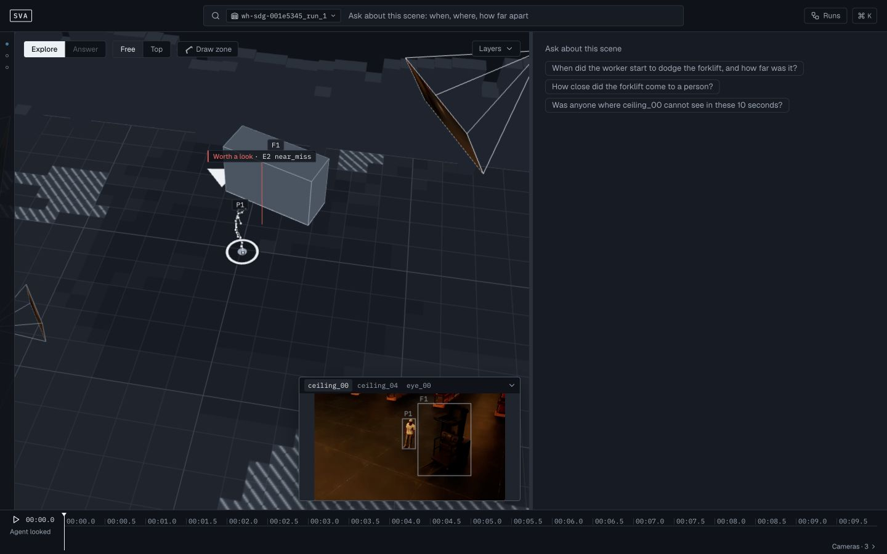
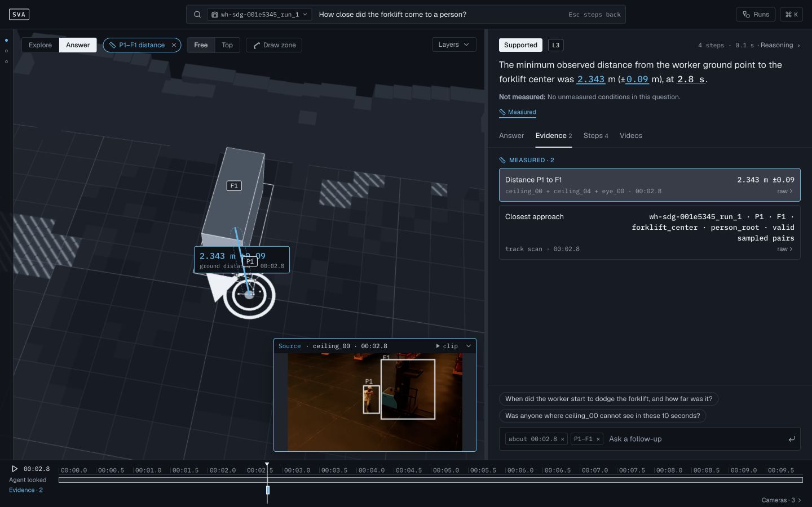
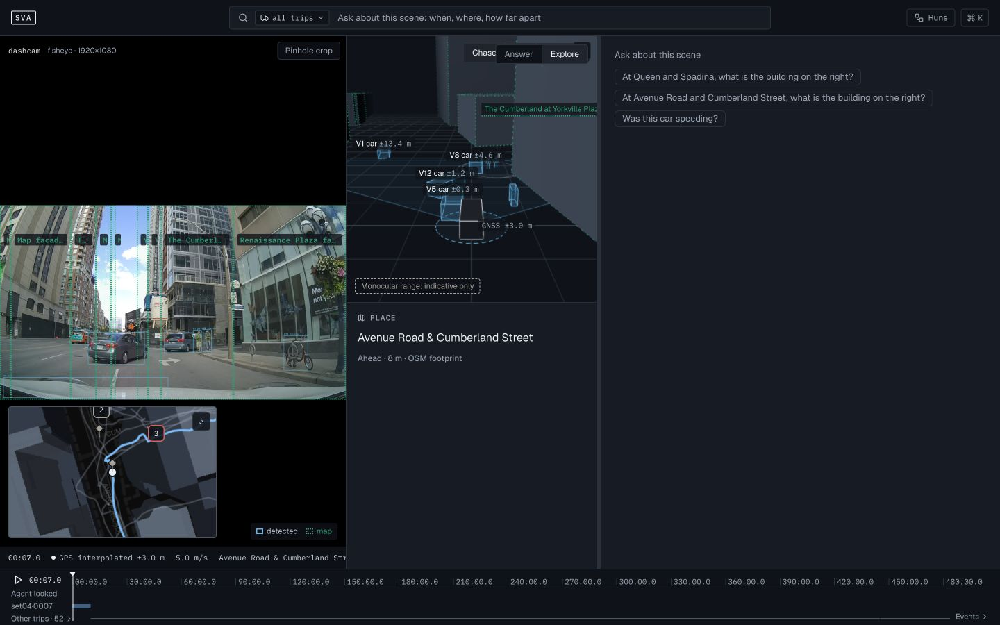
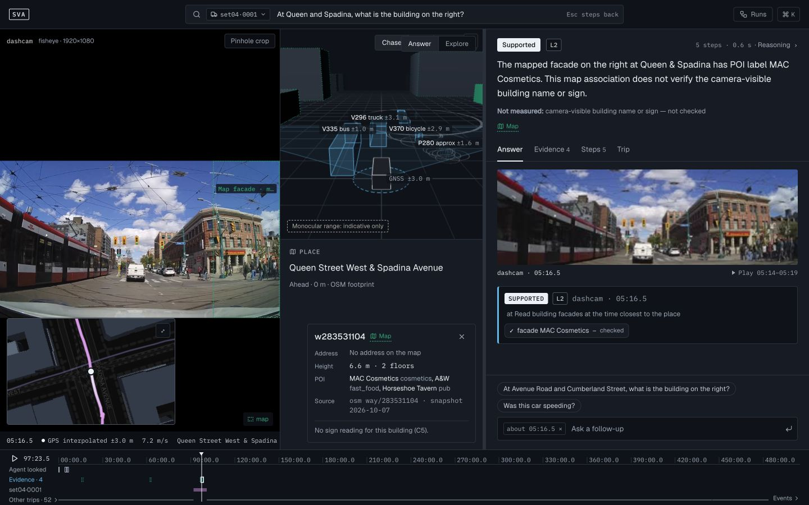
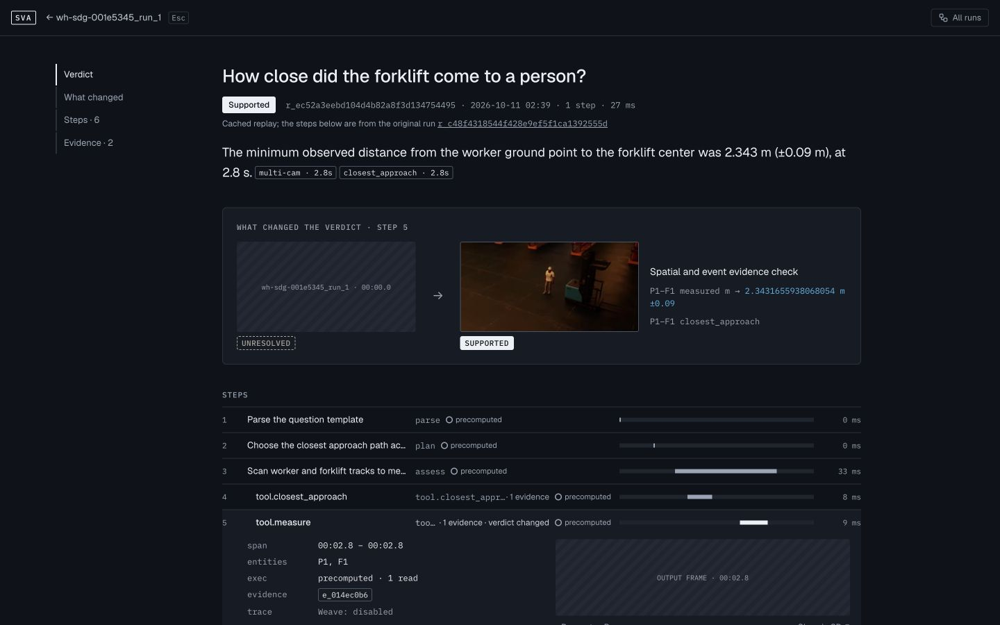
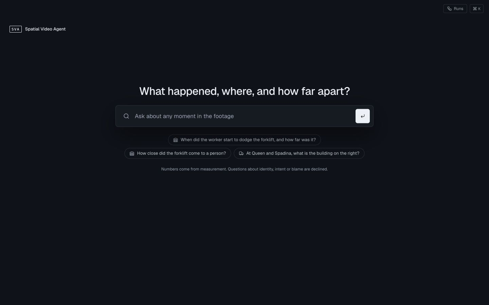
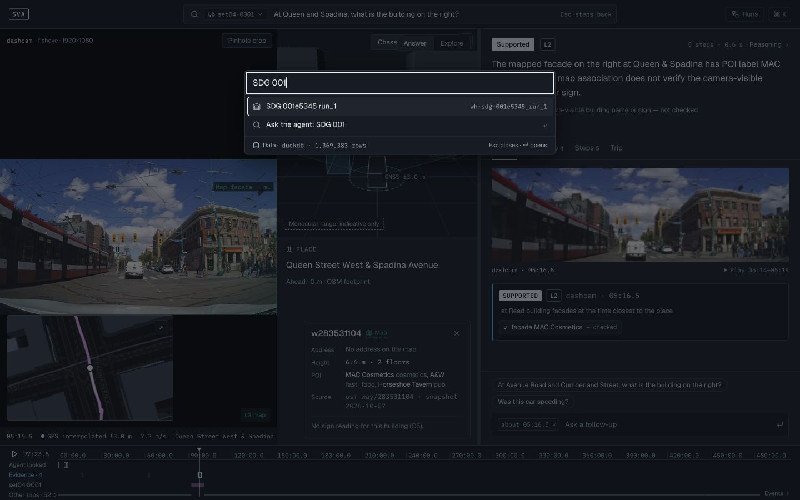
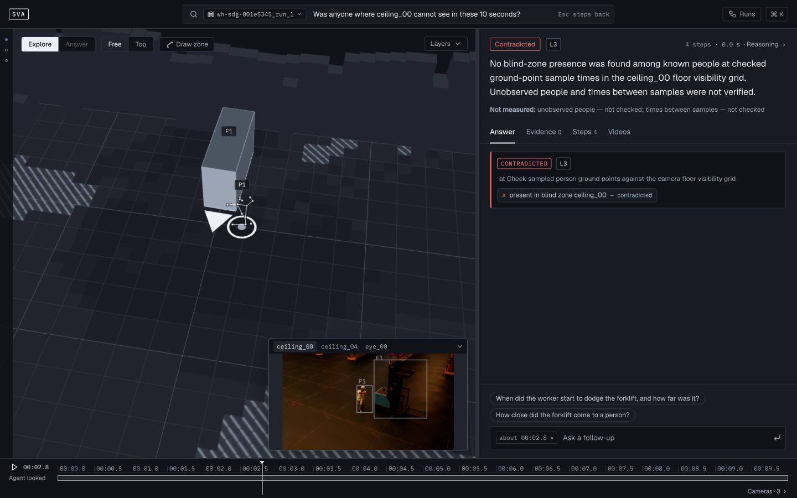

# Spatial Video Agent (sva)

Spatial Video Agent is an investigation workbench for multi-camera warehouse surveillance, fleet dashcams and street cameras. You ask a question in one sentence. The agent searches candidate moments, reads more camera views when needed, and shows their evidence in 3D, on a map or in the source video. Quantitative claims use recorded evidence and explicit measurement fields: CV and geometry, GPS/OBD telemetry, map data and source timestamps. Models parse the question, write captions and narrate. The agent marks each claim SUPPORTED, CONTRADICTED or UNRESOLVED, and it abstains when the scene cannot answer the question.


*The deployed app reporting the minimum observed worker-to-forklift distance in warehouse scene `wh-sdg-001e5345_run_1`.*

## Contents

- [Features](#features)
- [How to use](#how-to-use)
- [Questions to try](#questions-to-try)
- [Deployed version](#deployed-version)
- [Repository layout](#repository-layout)
- [Development run](#development-run)
- [Tests](#tests)
- [Pipeline](#pipeline)
- [Site deployment](#site-deployment)

## Features

### Question-first agent

- One question box. `POST /api/agent/ask` streams the run as server-sent events (`step`, `tool_call`, `tool_result`, `hits`, `model_result`, `ui`, `claim`, `answer`, `status`, `done`; [CONTRACT.md §7](CONTRACT.md#7-sse-spec-73-schemasask_ssejson)). The panel fills in as frames arrive.
- The agent works in fixed states: parse, plan, retrieve, inspect, measure, assess, answer. While it runs, a narration card over the stage shows `STEP n OF 6` with the segments Parse, Search, Inspect, Measure, Check, Answer, and the moments and claims found so far.
- Each claim has predicates with a status and the evidence they were decided on. A claim is SUPPORTED, CONTRADICTED or UNRESOLVED, and the panel shows when a step changed it (for example `UNRESOLVED -> SUPPORTED`).
- The final verdict is one of Supported, Contradicted, Unresolved, No match, Out of range or Out of scope (UNSUPPORTED). For the last three, the panel says why and offers questions that can be answered instead.
- Every number in an answer sentence comes from an evidence field. Each one is a button that opens its evidence.
- Every source is labelled: Measured, Map, Model or Human. Numeric Measured badges require a measurement reference; the panel also shows the scene evidence level and a **Not measured** explanation. Model output (Cosmos situation, prediction, timing, sign reading) "describes only, no numbers" and shows whether a measurement checked it.
- While the agent moves the view, a pill says "Agent is steering the view". **Take over** (or a click on the stage) gives you the camera; the agent can still seek the clock and highlight objects.

### Warehouse 3D stage



- A full-bleed three.js stage: the scene as block massing (the raw point cloud is an extra layer), people as 3D skeletons, the forklift as a box with a bright front face, and one frustum per camera. A frustum base shows that camera's thumbnail of the current second.
- **Camera rail** on the left: a strip of dots that expands to thumbnails on hover. Click a camera to view the scene from it. Cameras the agent used are marked "used by agent".
- **Views**: Free and Top, plus the view from any camera.
- **Layers** popover: People + skeletons, Forklift, Agent measures, Blind spots, Point cloud, Camera frustums, and the source legend. The choice is kept across reloads.
- **Blind spots**: from the per-second visibility grid, floor cells that no camera sees are hatched and cells that fewer cameras see get a stronger tint. A person seen by one camera only is tagged "single view".
- Warehouse distance lines join the person’s ground point to the forklift center. Rule near-miss clearance has a separate definition; center distance does not prove or disprove that clearance threshold.
- Explicit person/forklift ID distance questions use valid samples without requiring a near-miss event. With no timestamp, the answer names the **minimum observed** distance and sampled window. Scalar tracked speed and world ground position require one scene, one identifiable entity and a timestamp; missing samples or uncertainty remain unresolved. A position answer gives coordinates, frame, source and numeric evidence, independently of camera visibility.
- **Distances**: a measured ground distance is drawn as a line between the two actors, labelled with value and sigma (for example `3.208 m ±0.09`), for the time span of the moment.
- **Explore | Answer** modes. Answer mode is the default; it keeps the cited actors at full strength, dims the rest, frames them, and docks the source frame of the camera the evidence was read from (with a **clip** button that plays from 2.5 s before). A focus chip names the evidence; its x returns to Explore.
- **Worth a look** pins mark rule events of severity 2 or more; a click seeks to them.
- Click a person or the forklift to outline it everywhere and get an **Ask about this** button, which puts its id into the question box.
- Where presented-frame callbacks are available, paused seeks retain their actual timestamp through loading and seek readiness. Camera and chunk changes discard old callbacks; annotations wait for a valid presented frame.
- **Videos** tab (after an answer): the moment's cameras, synced to the timeline, primary camera large, boxes drawn on each frame, "No video" hatching where a camera has none; **Pin to stage** opens one camera as a picture-in-picture on the stage.
- **Draw zone**: click floor points, double-click to close; the timeline then keeps only the events inside the zone. Drawing a zone stores it on the server (`POST /api/scene/<key>/zone`).
- Watch mode: when playback crosses a severity 2+ event while no question is open, the app creates one review task and a hazard zone for it (`POST /api/actions/trigger`, once per event) and shows a toast with **View**.



### Fleet map



- A full-bleed MapLibre map from local PMTiles (basemap and 3D building massing); the app requests no outside tiles.
- Fleet requests are limited to six concurrent reads. The overview loads route data first; other trip details load when selected. A failed trip or detail asset has a local retry and does not discard the rest of the fleet.
- **Trips**: each trip has its own colour on route, car arrow and timeline lane. Click a car or its trip tag to select it; the selected trip draws its trail and the others fade.
- **Replay clock**: trips were not filmed at the same time, so they play on one simulated clock ("Simulated clock"). Cars move with it, and a trip outside its time hides its car. Cars with video show a dashcam thumbnail chip.
- **GPS gaps**: a gap longer than 2 s is not interpolated. The car is drawn as last known, with its age ("last fix 1.5 s ago"); gaps also show on the trip lane.
- **Event pins and clusters**: crowded pins merge into a counted cluster; a cluster click zooms in, a pin click selects its trip and seeks to the event.
- **Building card**: click a building (on the map, in the dashcam frame or in the 3D view) for its name, address, height and floors, points of interest, map source and snapshot date, and the Cosmos sign reading with its check against the map ("Sign check").
- **Intersection view** (after an answer on a trip with video): a 2x2 layout of dashcam video | map, over ego-frame 3D | place card.
  - Dashcam: detection boxes and building facade columns, **Pinhole crop** for the fisheye camera, and a fact line (time, GPS state and sigma, speed, place, playback rate).
  - Map: the car in a dashed ring whose radius is the GPS sigma ("Dashed ring = GPS uncertainty").
  - Ego-frame 3D: the car at the origin, pedestrians and vehicles with labels and sigma, buildings; views **Chase**, **Top**, **Dashcam**; badge "Monocular range: indicative only".
  - Place card: the place under the car from the map, its side and distance ("Ahead · 6 m"), and the Cosmos C5 reading with "checked by map".
- **Trip** tab: the trip, whether GPS had a live fix during the moment, other passes near the same place, duration and distance.
- Video loading, buffering and decode errors are shown separately from timeline coverage. Unavailable media hides stale frames and annotations; **Retry video** retains the current investigation.



### Timeline

- A ruler you can drag to seek, a play/pause button and the current time. Tick spacing adapts to the available width and long trip durations.
- Clicking a source-time reference seeks to that field’s instant, including a street peak inside a longer window. Duration, speed and uncertainty references keep ordinary evidence navigation.
- **Agent looked**: the time ranges each tool call read.
- **Evidence · N**: one mark per evidence, styled by its kind. Hover an answer number to outline its mark; click a mark to focus that evidence.
- Warehouse: **Cameras · N** opens one coverage lane per camera (ok, occluded, no video) and the **Events** lane. After an answer, model lanes **Cosmos C4** and **Prediction** appear.
- Fleet: a lane per trip (GPS fix or gap; the open trip, or the first, stays; the others fold behind **Other trips · N** until it is clicked) and the events of all trips.

### Run page



- `#/run/<run_id>` shows one stored run: the question, verdict, run id, date, step count and time, and the answer sentences with their cites (a sentence without cites is muted and marked "Not supported").
- A section nav: **Verdict**, **What changed** (the step that changed the verdict, with before and after frames), **Steps · N**, **Evidence · N**, **Model notes · N**, **VSS comparison**.
- Running run pages refresh until completion and stop refreshing when closed. Each verdict change uses its own claim, step and moment.
- Steps: name, summary, exec state (live, cached, waiting, failed) and duration per step and tool call; a click expands its input and output, the Request and Response JSON, and its evidence.
- Evidence: source, a readable label, cameras and time, value, and **raw** fields.
- Model notes: Cosmos C1 situation, C2 prediction, C4 timing, each with "Checked by measure" or a conflict.
- VSS comparison: what the site VSS native search returned for the same question, with its SQL, "For comparison only · not used in the answer".
- **Open in Weave** links to the W&B Weave trace when the run has one. A cached replay names the original run.
- `#/runs` lists recent runs with verdict, question, run id, date, steps and time, and marks cached replays.

### Evidence levels

Each scene has a level that decides what the agent may claim ([CONTRACT.md §8.5](CONTRACT.md#85-agent-per-evidence-level-t4) has the full table):

| Question type | L3: synthetic warehouse (SDG) | L2: SmartSpaces warehouse | L2: PIE dashcam trip | L1: street camera |
|---|---|---|---|---|
| find / event / presence | events and detections; captions describe | same | events and detections; captions describe | 2D presence; caption is model evidence |
| distance / near miss / closest | ground distance in m with sigma | UNRESOLVED (`scene_not_metric`) | ego-frame distance | UNRESOLVED (`no_geometry`) |
| where | world position | ground position | GPS place and ego position | UNRESOLVED (`no_geometry`) |
| blind spot | visibility grid | visibility grid if present | not checked | not checked |
| speeding / building | not checked | not checked | OBD vs map limit / OSM facade | not checked |
| same person (link) | entity association | entity association | entity association | UNRESOLVED (`no_track_ids`) |
| identity / intent / blame | UNSUPPORTED | UNSUPPORTED | UNSUPPORTED | UNSUPPORTED |

- **L3**: synthetic warehouse scenes (NVIDIA SDG) with calibrated cameras, depth and ground truth. Metric distances, world positions and blind spots.
- **L2**: real scenes with partial geometry. SmartSpaces warehouse cameras (ground position, not metric) and PIE dashcam trips (GPS, OBD speed, ego-frame distance, building facades).
- **L1**: street video with only 2D detections and captions. Spatial questions end UNRESOLVED (`no_geometry`). The deployed corpus includes 10 L1 street scenes. Their workspace supports full-window ByteTrack track counts and peak simultaneous person detections per second. Counts describe observed camera tracks, not unique people across cameras. Crossing and spatial relationships remain UNRESOLVED (`no_geometry`).

## How to use

### 1. Home page and asking



Open the app at `/app/` (`#/`). The home page has one box, "Ask about any moment in the footage", and three example questions (two warehouse, one fleet). Type a question and press Enter, or click an example.

- Type `@` in the box to pick the source: one list of warehouse scenes, fleet trips and street cameras (`set01·0001` is trip `fl-pie-set01_video_0001`), filtered by what you type after `@`. Use the Up and Down arrows and Enter (or a click) to pick one; it becomes a chip in the box, and its x removes it. The last row, "Leave empty and the agent picks the scene", clears the chip. Escape closes the list.
- Without a chip, the question searches the corpus. Explicit source chips constrain it to that scene or workspace.
- The question keeps running while its workspace opens on the first hits.
- A question the agent declines stays on the home page with a "Not answerable from footage" card and two questions to ask instead.
- If you were in a warehouse scene before, the home page draws that scene behind the box and names it top right.

### 2. Workspaces and the ⌘K palette

- The top bar has the Ask box with a source tag (the current scene key, trip, or `all trips`), **Runs**, and **⌘K**.
- Press ⌘K (Ctrl+K on Windows and Linux), click the **⌘K** button, or click the source tag to open the palette. It lists every warehouse scene, **All trips**, every trip and **Recent runs**. Type to filter (for example `set03`), Up and Down to move, Enter to open; Esc closes. When text is typed, the last row is "Ask the agent: <your text>". The footer shows the data backend and its row count.
- Routes: `#/warehouse/<scene_key>`, `#/fleet` (all trips), `#/fleet/<trip_id>@<t_ms>` (one trip at a time), `#/street/<scene_key>`, `#/runs`, `#/run/<run_id>`.



### 3. Presets

The right panel of a workspace starts with "Ask about this scene" and three preset questions:

| Workspace | Presets |
|---|---|
| Warehouse | When did the worker start to dodge the forklift, and how far was it? · How close did the forklift come to a person? · Was anyone where ceiling_00 cannot see in these 10 seconds? |
| Fleet | At Queen and Spadina, what is the building on the right? · At Avenue Road and Cumberland Street, what is the building on the right? · Was this car speeding? |

Street presets cover observed track count, peak simultaneous person detections and an unsupported crossing relationship.

### 4. While the agent runs

- The narration card shows the current step, a 6-segment progress bar, **Steps** (the list of steps so far) and **Stop**. Stop ends the run as "Stopped" and keeps what arrived.
- The answer slot is reserved at the top of the panel; moments found ("MOMENTS FOUND · N") and "CLAIMS SO FAR" fill in below.
- **Take over** in the pill "Agent is steering the view" (or any click on the stage) stops the agent from moving your camera.

### 5. The answer panel and its tabs

- The panel starts at 40% of the desktop width. Drag or use the keyboard on its separator to resize it between one third and two thirds; narrow screens use a stacked layout.
- Header: evidence level, verdict, step count and time, and **Reasoning** (opens the run page). The answer sentence follows, then the source badges.
- **Answer** tab: the key frame of the top moment with **Play** (from 2.5 s before), the claims with before -> after and their predicates and measured values, the model note (click it to expand all model rows), and **Other moments · N**.
- **Evidence · N** tab: evidence grouped by kind (MEASURED, MAP, MODEL, HUMAN). Each row has a label, value with sigma, cameras and time; **raw** shows the stored fields.
- **Steps · N** tab: every step and tool call with its duration and exec state, the step that changed a claim, a duration bar, the link "Full reasoning, tool calls and VSS comparison", and the "VSS native search" block when the site adds one.
- **Videos** (warehouse) or **Trip** (fleet) as the last tab.
- Moment cards merge their conditions and evidence. Model timing is labelled **Model says ≈** and is not a measured time.
- A new question resets the panel to the Answer tab. Ordinary scene navigation clears the previous question and answer.

### 6. Clicking evidence and numbers

- Hover an underlined number in the answer: its evidence row, its timeline mark and (for a distance) the 3D line light up.
- Click the number, a cite, an evidence row or a timeline mark: the clock seeks to the evidence, the stage enters Evidence mode, and the evidence rows flash.
- Click a moment card to seek to it and select its actors.

### 7. Esc steps back one layer

Each Esc press goes back one layer, in this order:

1. closes the ⌘K palette;
2. closes the run page and returns to the workspace under it;
3. leaves Evidence mode (back to Explore);
4. goes back to the Answer tab;
5. clears the answer (the stage returns to its default state);
6. with no answer open, goes to the home page.

On the home page, Esc closes the `@` list. The command palette keeps keyboard focus inside the dialog and returns it to its invoker. The timeline supports arrow keys, Page Up/Down and Home/End; event and evidence marks activate with Enter or Space. The top bar reminds you: "Esc steps back".

### 8. Follow-up questions

After an answer, the panel ends with suggested follow-ups and the box "Ask a follow-up". Removable context chips show the selected object ids and clock time (for example `P1 · F1 · 00:01.6`). A follow-up constrains the investigation to those objects and that moment. A timeline brush or drawn zone also constrains the request. Conflicting or unsupported constraints remain UNRESOLVED rather than silently broadening the search. Changing workspace clears the selection. For a point position or scalar speed, use an explicit time context such as the `about 00:01.0` follow-up chip. A fresh top-bar question does not automatically use the cursor as its time anchor.

### 9. Runs and the run page

- **Runs** in the top bar (or **Recent runs** in ⌘K) opens `#/runs`; click a row to open that run.
- **Reasoning** in the answer header opens the run page of the current answer.
- The back button at the top left (or Esc) returns to the workspace; **All runs** goes to the list; **Open in Weave** opens the trace in W&B.

## Questions to try

These examples use the real ws corpus. Results depend on the selected source, time and available evidence; unsupported conditions remain unresolved.

| Workspace and source | Question | Result |
|---|---|---|
| Warehouse, `wh-sdg-001e5345_run_1` | How close did the forklift come to a person? | Minimum observed worker ground point to forklift center distance: 2.343 ±0.09 m at 2.8 s. This is not footprint clearance. |
| Same warehouse, explicit 2.8 s context | Where is P1? | Scene world ground coordinates x=0.008 m, y=-0.861 m, ±0.09 m, source `tri`. |
| Same warehouse | When did the worker start to dodge the forklift, and how far was it? | Unresolved when model event interpretation conflicts with recorded evidence; independent distance evidence remains available. |
| Same warehouse | Was anyone where ceiling_00 cannot see in these 10 seconds? | A negative result is limited to known people at checked ground-point sample times in the floor visibility grid. Unobserved people and times between samples are not verified. |
| Fleet, all trips | At Queen and Spadina, what is the building on the right? | The mapped facade has a MAC Cosmetics POI label. A map POI label does not verify a camera-visible building name or sign. |
| Fleet, all trips | Was this car speeding? | OBD speed 72.02 km/h against a map limit of 40 km/h for the primary candidate. Other moments retain their own source and assessment. |
| Street, `st-sf_streets_cam_4-sf4` | When is the street busiest in this clip? | Peak of 16 simultaneous person detections at 61.733 s in the checked 0–900 s window. |
| Warehouse | Who is the person in eye_00? | Out of scope: identity, intent and responsibility are not inferred. |



Phrasings the question parser recognizes (`app/core/llm.py`):

- **Find, when, how far**: find, show, list, when, did, was, is there, distance, gap, closest, how close, how far, nearest, speed, speeding, dodge, yield, give way, step back. Examples: "How far was it from the forklift?", "Was this car speeding?".
- **Blind spot**: blind, can't see, cannot see. Example: "Was anyone where ceiling_04 cannot see?".
- **Where**: where, near, building, junction, intersection. Example: "At Queen and Spadina, what is the building on the right?".
- **What happened**: what happened, describe, explain.
- **Same person**: link, same person, before ... after.
- Entity ids such as `P1` (person), `F1` (forklift) and `V7` (vehicle) name objects in the open scene.

The agent declines (verdict Out of scope, UNSUPPORTED) questions about identity, intent or blame: anything with "who is", "who was", "identity", "name of", "intent", "purpose", "trying to", "wants to", "motive", "who caused", "deliberately", "why", "fault" or "responsible". Example: "Who is the person in eye_00?", "Why did the driver stop?", "Whose fault was the near miss?". Ask what can be measured instead: when, where, how far apart, whether it appears.

Unsupported attributes, quantities, negation, temporal conditions and exhaustive claims remain UNRESOLVED unless their predicates can be checked. A top-k search does not prove "all" or "none". Model events cannot supply measurement references.

A question about a place or time outside the footage ends Out of range; a search with no hits ends No match ("That does not mean it did not happen").

## Deployed version

Validated on ws on 2026-10-10 (America/New_York; 2026-10-11 UTC), using real corpus data. The tested code release is `c06e85fb4c07c167d29458ebb7962ff4df211ab5`; `/api/dependencies` identifies the currently deployed commit, including later documentation-only updates.

| Item | Value |
|---|---|
| Source | Public `main`; `/api/dependencies.source_commit` reports the deployed source when `SVA_COMMIT` is set at startup |
| ws mode | `MODE=dev`, `DATA_BACKEND=duckdb`, local real corpus, root path |
| Corpus | 143 scenes / 4,188 clips: 80 warehouse scenes, 53 fleet trips, 10 street cameras |
| Dependency status | `/api/dependencies` reports inexpensive TCP reachability separately from `/health`; it does not certify inference |
| Asset readiness | All 143 local scenes passed readiness; S3 releases validate indexed manifests and direct references asynchronously before readiness |
| Runtime acceptance | 25 completed real investigations, 40 numeric references and 12 targeted semantic/source checks passed; original 2 actions and 2 zones retained |
| Real UI | Answer/evidence navigation, Fleet first → GPS-only candidate → cited first candidate, panel keyboard resizing, command palette focus and 486 px layout checked |

LLM and Cosmos completed separate inference smoke requests during this repair session. TCP reachability alone is not an inference or accuracy benchmark. The older VAST site deployment is described in the deployment guide; its current state, real S3 and VastDB end-to-end behavior are outside this ws acceptance.

The nine walkthrough images were recaptured from the accepted ws release at 1440 × 900. The browser supplied native JPEG captures; PNG exports preserve the decoded pixels exactly, without resizing, cropping, image adjustments or further lossy encoding. [Capture provenance](docs/screenshots/capture.json) records source and pixel hashes.

## Repository layout

| Path | Contents |
|---|---|
| `app/main.py`, `app/api/` | FastAPI app: health, workspaces and scenes, assets, search, fleet, actions, agent (`POST /api/agent/ask` streams SSE) |
| `app/core/` | Agent tools and policy, geometry, store (DuckDB or VastDB), VSS client, Cosmos VLM, embeddings, LLM, Weave trace, query cache |
| `app/static/` | Browser UI without a build step: home, warehouse 3D stage (three.js), fleet map (MapLibre + PMTiles), run page |
| `app/scripts/` | `bootstrap.py` (pod entry point), `vendor.py` + `vendor_manifest.json` (browser libraries pinned by SHA-256), `configmap_size.sh`, `gate.sh`, `deploy_site.md` |
| `app/tests/` | `unit/`, `contract/` (pytest) and `e2e/` (Playwright) |
| `pipeline/` | Offline pipeline: `warehouse/`, `fleet/`, `street/`, `map/`, `common/` (schema check, publish, upload, index build, site map), `eval/` |
| `schemas/` | JSON Schemas of the artifacts, SSE events and API bodies; SQL of the index and app tables |
| `fixtures/` | Small synthetic scenes and the generator `gen_fixture.py`, used by the tests and by dev mode |
| `docs/screenshots/` | The screenshots in this README |

The real scene artifacts (`sva-out/`), the index and the source videos are not in Git. Tests and the development command below use only `fixtures/`. The ws launch script selects the real local corpus explicitly.

## Development run

Run all commands from the repository root. Python 3.12. `app/requirements.txt` pins the dependencies.

```bash
uv venv -p 3.12 .venv
VIRTUAL_ENV=.venv uv pip install -r app/requirements.txt
.venv/bin/python app/scripts/vendor.py
.venv/bin/python app/scripts/vendor.py --check
```

Start the app on the synthetic fixtures:

```bash
.venv/bin/python fixtures/gen_fixture.py --no-media --index index.duckdb
MODE=dev DATA_BACKEND=duckdb ASSET_DIR=fixtures/sva-out INDEX_DUCKDB=index.duckdb \
APP_DUCKDB=app.duckdb RUNS_DIR=runs LIB_DIR=app/static/lib PUBLIC_BASE_PATH= PORT=8300 \
.venv/bin/python -m uvicorn app.main:app --host 127.0.0.1 --port 8300
```

Open `http://127.0.0.1:8300/`. The question parser uses deterministic templates first; the LLM classifies only questions without a template keyword (`app/core/llm.py`). The pseudo-vectors of the fixtures are for contract and page tests only; they are not evidence of retrieval accuracy. The environment variables for the model services, VSS, S3, VastDB and W&B are listed in [CONTRACT.md §6.3](CONTRACT.md#63-environment-variables-spec-122). The code never prints the value of a secret. Answer caches include model, code and evidence identity with a short TTL; `EVIDENCE_REVISION` can identify a new release. Cosmos cache reuse requires matching source material and model identity. Failed app-state mirrors remain in a local outbox. With the app stopped, `.venv/bin/python -m app.scripts.retry_mirrors` retries them without dispatching notifications. Notifications record delivery per channel, retry failed channels and preserve previously delivered actions across upgrades. Startup transactionally rebuilds the legacy action scene/event index once, preserving table rows and uniqueness; unchanged duplicate triggers avoid LIST rewrites. `/health` also checks the app-state connection, so an unreadable state database is unready.

## Tests

```bash
(cd app && npm install && npx playwright install chromium)
bash app/scripts/gate.sh
.venv/bin/python -m pytest pipeline -q
```

`gate.sh` runs all pytest suites, the fixture schema check, the fixture determinism check, the vendor manifest check, the Playwright e2e (root path and `/app` prefix), the ConfigMap size check and a secret scan. Set `SVA_E2E_PORT` to give a parallel run its own port.

Release validation: **857 backend tests, 520 UI tests (260 root + 260 prefixed), 112 contract tests and 68 pipeline tests passed**. Schema validation, 31 generated fixture files with no differences, 19 local vendor hashes, ConfigMap size (3,950 bytes) and the tracked-source/new-commit secret scan passed. Backend and contract used `c06e85f`; UI used `ceda23e`. Their application code, UI tests, fixtures, schemas and pipeline Git blobs/modes are identical; only the corrected Python map-wording test differs.

The e2e specs in `app/tests/e2e/` describe each interaction of the UI above: `home.spec.js`, `shell.spec.js`, `kernel.spec.js`, `warehouse.spec.js`, `fleet.spec.js`, `fleet-intersection.spec.js`, `timeline.spec.js`, `run.spec.js`, `runpage.spec.js`.

## Pipeline

The GPU pipeline produces the scene artifacts offline: warehouse depth points, visibility, pose and triangulation, forklift and events; fleet trip selection, detection and tracking, GPS map matching, building facades; then Cosmos records, the index and the schema check. Each step writes to `sva-out/_tmp/<card>/<scene_key>/`. Only `pipeline/common/publish.py` moves a scene that passes `schema_check.py` to `sva-out/<scene_key>/`. `pipeline/common/upload.py` copies the artifacts to S3, and `pipeline/common/index_build.py --vastdb` writes the index tables to VastDB. `pipeline/requirements.txt` lists the pipeline dependencies (torch needs the CUDA wheel index). The input data sets are not in this repository.

## Site deployment

[app/scripts/deploy_site.md](app/scripts/deploy_site.md) gives the steps for the workshop VM: Secret, bootstrap ConfigMap, Deployment + Service + Ingress at `/app` on the team host, and the health and SSE checks.

[REUSED.md](REUSED.md) lists the files taken from earlier demos.
